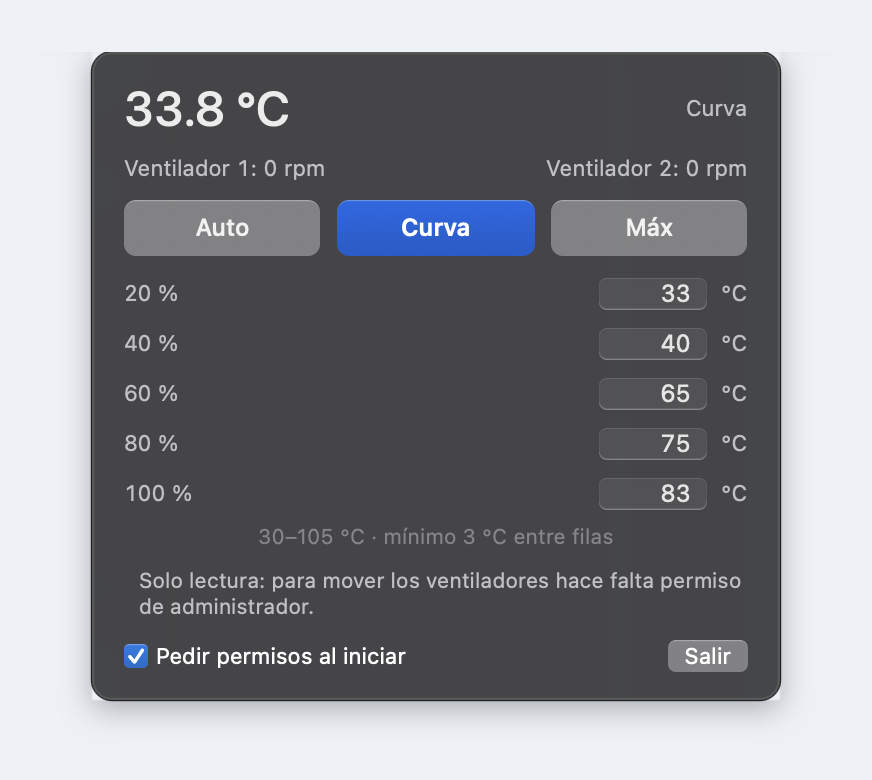
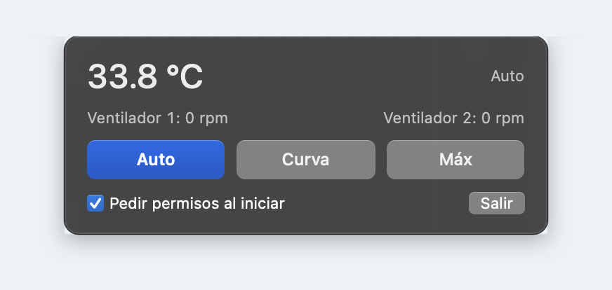

<p align="center">
  
</p>

<h1 align="center">FanLite</h1>

<p align="center">
  <b>One temperature curve. One max button. No daemon.</b><br>
  Minimal fan control for Apple Silicon Macs, in a single process.
</p>

<p align="center">
  <a href="https://github.com/stavitian/fanlite/releases/latest"></a>
</p>

<p align="center">
  
  
  
  
</p>

**English** · [Español](README.es.md)

---

## Why FanLite

Apple Silicon Macs keep their fans off, or very slow, until the chip is already hot. That is quiet,
but when you render, compile or game for a long time your Mac runs warm and may slow itself down.
FanLite gives you the useful part of fan control without installing anything:

- **One curve, five rows.** Set the temperature for 20 / 40 / 60 / 80 / 100 % of the fan range.
  FanLite interpolates between them and follows the curve live.
- **A max button.** Full speed when you want it.
- **One process.** No helper, no daemon, no LaunchAgent. The app re-executes itself with
  `sudo -A` only when you ask it to control the fans.
- **Nothing left behind.** When FanLite quits, the fans go back to macOS.

It started as a trimmed-down version of [FanPilot](https://github.com/zyvren/FanPilot): same SMC
knowledge, minus the daemon, the sensor catalog, the rules and the extra windows.

## Screenshots

<table>
  <tr>
    <td width="50%" align="center"></td>
    <td width="50%" align="center"></td>
  </tr>
  <tr>
    <td align="center"><b>Curve</b>: five fixed percentages with an editable temperature each.</td>
    <td align="center"><b>Auto / Max</b>: the curve rows disappear; below the modes only the footer stays.</td>
  </tr>
</table>

## Download and install

1. Download **FanLite-1.0.0.dmg** from the [latest release](https://github.com/stavitian/fanlite/releases/latest).
2. Open it and drag **FanLite** onto **Applications**.
3. Open FanLite from Applications. It lives in the menu bar; there is no Dock icon.
4. On first launch macOS may say it cannot verify the app. FanLite is open source and not notarized
   (that needs a paid Apple Developer account). Open it once, then go to
   **System Settings → Privacy & Security**, scroll down and click **Open Anyway**. You only do
   this once. From Terminal you can also run:
   `xattr -dr com.apple.quarantine /Applications/FanLite.app`

**Requirements:** a Mac with Apple Silicon (M1 to M5) and macOS 14 Sonoma or later. Macs without
fans (MacBook Air) get monitoring only.

## First run and permissions

- **The first launch never asks for the administrator password.** FanLite opens read-only so you can
  see temperatures and fan speeds immediately. To control the fans, click **Curva** or **Máx**:
  macOS asks for the password once, through the standard `sudo` dialog.
- **Auto never asks.** It only reads temperatures and hands the fans back to macOS.
- There is no helper and no daemon. The app writes to the SMC from the same process after asking
  `sudo` to re-execute it as root. Nothing is installed system-wide.
- After the first launch, the **“Pedir permisos al iniciar”** checkbox (enabled by default) decides
  whether FanLite asks at launch when the last used mode was Curva or Máx. Turn it off to be asked
  only when you choose a control mode.
- Use `--no-elevate` to skip the launch prompt even when the checkbox is enabled. Choosing Curva or
  Máx later still asks for the password.
- When FanLite exits (Quit, ⌘Q, Ctrl-C, SIGTERM), every fan is returned to Auto.

## What it does

- **Curve**: five rows for **20 / 40 / 60 / 80 / 100 %**. Each row has an editable temperature in
  °C. Values are validated automatically: **30–105 °C**, at least **3 °C** between rows, and an
  edited row is clamped between its neighbors. Defaults: **33 / 40 / 65 / 75 / 83 °C**.
  Below the first row the curve asks for **0 %**: the fans are handed back to macOS, which stops
  them at low temperatures. They are engaged again when the temperature crosses the first row.
- **Auto / Máx / Curva**: three full-width buttons, with the selected mode painted in the system
  accent color (blue if the accent is graphite). In Auto and Máx the curve rows, the hint and the
  read-only note are hidden; below the buttons only the footer remains.
- **Fan row**: one label per fan, spread across the panel; with two fans, fan 1 is on the left and
  fan 2 on the right.
- **Menu bar**: the current CPU/GPU temperature. Right-click the icon for a menu with *Open panel*
  and *Quit*.
- **Lazy panel**: built on first open and released on close. While it is closed the app does not
  repaint views or read actual RPM that nobody is going to display.
- **One instance.** The config lives in `~/Library/Application Support/FanLite`; the log is
  `~/Library/Logs/FanLite.log`.

## Safety

FanLite writes fan targets, so it is deliberately conservative:

- Every target is **clamped** to the fan's real minimum and maximum (`F<n>Mn`/`F<n>Mx`).
- **Thermal failsafe**: if the raw temperature reaches **93 °C**, the fans go to maximum regardless
  of the curve.
- **No readings, no control**: if there are no valid temperature readings for about 30 seconds, the
  fans are returned to Auto and the mode switches to Auto.
- **Smoothed temperature** (alpha 0.4) so core-level noise does not make the fans step, and a
  **write deadband** of ~1 % of the fan range so a 0.1 °C change does not produce an SMC write.
- On every exit, mode 0 is written to every fan before the process terminates.

There is no daemon, by design. If the process dies abruptly (crash, `kill -9`), the fans stay in
manual mode with the last target until another controller releases them or the Mac restarts. If you
need a helper with a lease that returns the fans automatically, use
[FanPilot](https://github.com/zyvren/FanPilot).

## FanLite vs FanPilot

FanPilot is the full-featured project FanLite was extracted from. FanLite keeps one curve and a max
button; if you need per-model sensor names, Auto Boost rules, a sensor window, notifications or a
CLI, FanPilot is the better choice.

| | FanPilot | FanLite |
|---|---|---|
| Processes | 2 (app + root helper daemon) | **1** (re-executed with `sudo -A`) |
| Installed system-wide | helper in `/Library/PrivilegedHelperTools`, LaunchDaemon, socket | **nothing** |
| Fan control | manual RPM / %, Max, Auto Boost, Curve | **Curve + Max** (+ Auto) |
| Curve editor | drag free points | five fixed rows, editable temperatures |
| Sensors | per-model catalog + classifier | discovers `Tp*`/`Tm*`/`Tg*` once, caches them |
| Extra UI | sensors window, settings, diagnostics, CLI | one menu bar panel |
| Memory footprint (panel closed) | 42 MB + 5 MB | **~13 MB** |
| CPU with the curve active | ~3.7 % | **~0.3 %** |

The performance numbers were measured on a MacBook Pro M5 Pro (Mac17,9), macOS 27.2. They are
indicative: the curve editor and the lazy panel are the biggest differences.

## Build from source

Requires macOS 14+, Xcode or the Swift 5.10+ toolchain. No Apple Developer account is needed; the
app is ad-hoc signed.

```sh
git clone https://github.com/stavitian/fanlite.git
cd fanlite

swift build                      # debug build
scripts/build_app.sh             # build/FanLite.app (release, ad-hoc signed)
scripts/make_dmg.sh --build      # dist/FanLite-<version>.dmg and .zip

.build/debug/FanLite --simulate  # 52 control-logic checks against a fake SMC
.build/debug/FanLite --dump      # sensors, limits and current fan state
sudo .build/debug/FanLite --selftest   # supervised hardware test; returns fans to Auto
```

The app icon is generated by `scripts/make_icon.py` (requires Pillow). The `.icns` is committed, so
you only need this if you change the artwork.

`--simulate` covers the five-row curve, the below-first-row handoff, clamping, the failsafe, drift
re-assertion, the write deadband, legacy-curve migration and the reduced per-cycle SMC traffic.

## How it works

```
FanLite (single process)
  ├── SMC.swift        AppleSMC client: read keys, write fan mode and target
  ├── Controller.swift adaptive loop (1.5–3 s): temperature → curve → RPM, re-assert on drift
  ├── Model.swift      curve, validation and settings (JSON)
  ├── UI.swift         menu bar, five-row curve editor, floating panel
  ├── Simulate.swift   fake SMC + 52 logic checks (--simulate)
  └── main.swift       --dump / --selftest / --simulate / startup
```

- Fans use the standard SMC keys: `F<n>Ac` (actual RPM), `F<n>Tg` (target), `F<n>Mn`/`F<n>Mx`
  (limits), and `F<n>md` (mode: 0 = macOS, 1 = manual).
- The curve temperature is the **maximum** of up to 18 CPU/GPU sensors (`Tp*`, `Tm*`, `Tg*`),
  selected across sensor families on first run and cached so the SMC key catalog is not scanned
  again.
- In Curve mode, each cycle reads the fan mode and target; if macOS (thermalmonitord) changed the
  target, it is written again. In Auto, only the mode is read.
- Every target is **clamped** against the fan's min/max limits. Writes use a **1 % of range
  deadband**, and there is no read-back after every write: the next cycle already reads the target
  and detects drift.
- The panel is a borderless `NSPanel` with a visual-effect background. It is created lazily and
  released on close; its height follows the visible content, so Auto / Máx panels are much shorter
  than the Curve panel.
- The first GUI launch creates a `first-launch.done` marker in the support directory and skips
  launch elevation. The marker is separate from the config, which may be owned by root.
- On exit, mode 0 is written to every fan before the process terminates.

## Known limitations

- Root is required to write fan targets; there is no way around the SMC. FanLite asks once per
  launch and only when you are using Curve or Max.
- If the process dies abruptly (crash, `kill -9`), the fans remain in manual mode with the last
  target until another controller releases them or the Mac restarts. There is no daemon lease.
- Apple Silicon only; verified on a MacBook Pro M5 Pro (Mac17,9) with macOS 27.2. Other Apple
  Silicon Macs use the same detection and should work, but have not been tested.
- MacBook Air models without fans are monitoring-only.
- The menu bar UI is currently **Spanish-only**. This README is also available in
  [Spanish](README.es.md).
- Not notarized: the first launch requires **Open Anyway**.
- Use at your own risk. This software writes to the SMC; keep an eye on temperatures while testing
  a new curve.

## Credits

Created and maintained by [stavitian](https://github.com/stavitian).

The C AppleSMC layer (`Sources/CSMC/smc.c`, `Sources/CSMC/include/smc.h`) is derived from
**FanPilot** by [zyvren](https://github.com/zyvren), MIT licensed. See [NOTICE](NOTICE).

FanLite is an independent project and is not affiliated with Apple or any other fan-control vendor.

## License

MIT. See [LICENSE](LICENSE).

Use at your own risk: FanLite changes how your Mac cools itself.
